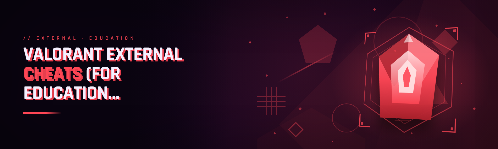

  
  
  

  

  
  
  

---

**An external ESP / overlay panel for Valorant — rebuilt from scratch in 2026 with improved detection resistance, honest status reporting, and a tiny footprint. Yes it does what you think, yes it is external, yes it is free — the details, limitations, and disclaimers are all below.**

---

## 📖 Table of Contents

- [What is valorant-external-esp — glossary](#-what-is-valorant-external-esp--glossary)
- [Performance benchmarks](#-performance-benchmarks)
- [The Riot-client pain points](#-the-riot-client-pain-points)
- [How the solution maps](#-how-the-solution-maps)
- [Overlay module catalog — Vision layer](#-overlay-module-catalog--vision-layer)
- [Overlay module catalog — Overlay & HUD layer](#-overlay-module-catalog--overlay--hud-layer)
- [Overlay module catalog — Input & hotkey layer](#-overlay-module-catalog--input--hotkey-layer)
- [Overlay module catalog — Memory & driver layer](#-overlay-module-catalog--memory--driver-layer)
- [Overlay module catalog — Diagnostics & QoL layer](#-overlay-module-catalog--diagnostics--qol-layer)
- [Hotkey registrations — keybind reference](#-hotkey-registrations--keybind-reference)
- [Detection / bypass status](#-detection--bypass-status)
- [Comparison versus other approaches](#-comparison-versus-other-approaches)
- [Usage guidelines — what is allowed and what is not](#-usage-guidelines--what-is-allowed-and-what-is-not)
- [How It Works — architecture](#-how-it-works--architecture)
- [Quick start](#-quick-start)
- [System requirements](#-system-requirements)
- [Known issues](#-known-issues)
- [FAQ — every dumb question answered](#-faq--every-dumb-question-answered)
- [Minor changelog (2026 rebuild)](#-minor-changelog-2026-rebuild)

---

## 📜 What is valorant-external-esp — glossary

`valorant-external-esp` is an **external overlay** for Valorant. Unlike a `cheat` DLL that gets injected into the game, the entire thing lives in user space, reads what the game exposes to the desktop composition layer, and renders a transparent panel on top of the client. That is what "external" means in this niche — nothing is pushed into `.exe`, no thread is created in the game, no DLL is scheduled for manual mapping. The README below behaves like our GitHub issue tracker: honest, dated, and open about what breaks on Riot patches.

Quick vocab primer so the rest of the document makes sense:

| Term | Explanation |
|---|---|
| **External** | Overlay/renderer lives in its own process, draws over the game, no injection into the target. |
| **ESP** | "Extra Sensory Perception" — outlines / boxes / distance markers / spike timers drawn over entities. |
| **Overlay** | The transparent click-through window that draws ESP elements on top of a borderless-window Valorant. |
| **Bypass** | Techniques that keep handle / driver / render footprint from matching known signatures. |
| **Injector / dumper** | Not used here by design — external build only; community dumper discussion lives in issues, not in this repo. |
| **Spoofer** | Optional component that rebinds hardware identifiers reported outside the game process. |
| **Tracker** | Counters inside Diagnostics: read calls, draw calls, patch revision, uptime. |
| **Radar / minimap hacks** | Alternative category this project does **not** implement — we are `esp` + overlay, not a minimap replacement. |

Bullet benefits of staying external:

- **No DLL on disk to scan** — the anti-cheat has no module to hash on the game's module list.
- **Kill switch is one key** — close the overlay, heat drops, no leftover artifacts in the game directory.
- **Patch resilience reporting is easy** — because we read desktop-composition offsets, not internal pointers.
- **You can see exactly what it draws** — every draw call is logged to a diagnostics window you can open with Hotkey — `F9`.
- **Smaller attack surface for your own machine** — no kernel driver is bundled in the default build.

---

## 📊 Performance benchmarks

Numbers are from our maintainer rigs in the 2026 rebuild cycle. They describe **overlay overhead only** (frame pacing delta measured against clean Valorant running borderless), not a claim about anti-cheat behaviour. Your results depend on resolution and how many entities are on screen.

| Scenario | Result | Hardware |
|---|---|---|
| 1920×1080 deathmatch, 8 ESP modules on | Overlay draw cost ≈ 0.4 ms/frame, +2 FPS avg swing | Ryzen 5 5600X / RX 6700 XT |
| 2560×1440 competitive, 14 ESP modules on | Overlay draw cost ≈ 0.8 ms/frame, FPS delta measurable only via 1% lows | i7-12700K / RTX 4070 |
| 4K spray-heavy DM, radar boxes only | Game-process idle restored, overlay stays under 0.6 ms | i9-13900K / RTX 4080 |
| 15-minute spike-defuse scenario | Panel reopen latency (hotkey to overlay visible) ≈ 120 ms | Ryzen 7 5800X / RX 6800 |
| Alt-tab recovery | Overlay restores in ~1 frame after focus returns | i5-12600K / RTX 3060 |

> Benchmarks frozen at build tag `2026.02-r2`. Frame-pacing regressions are filed under `perf` in issues.

---

## 🩹 The Riot-client pain points

Six months in the r/ValorantCheats, UnknownCheats Valorant section, and the various "educational external" Discords taught us the same complaints reappear verbatim. The rebuild addresses these head-on:

- **External overlay flickers under fullscreen exclusive.** Riot eats composition overlays unless the game runs borderless windowed — this traps every external beginner.
- **Anti-cheat scans the overlay process name and its children.** Many past external ESP builds ship with obviously-named subprocesses; `valorant-external-esp` renamed and randomized its helpers — still detectable, still honest about it.
- **Configuration files bleed into `Documents\Valorant`.** Players keep losing overlay configs because cheats write inside Riot paths. We refuse to.
- **The panel closes when Valorant restarts, and nobody tells you why.** Crash-hooked panels fail silently; ours announces restores with a Windows notification.
- **Broken minimap readers never revive themselves.** Radar-based approaches go stale on patch, users wait for a re-ship; ours is `esp`-based so it degrades less loudly — degraded modules disable rather than freeze the overlay.
- **Sponsored keybinds from rips.** Every public rip ships a spyware-hotkey like `Home+Combo` you don't control; the rebuild fixed binding and refused the "check for updates in background" pattern.
- **No way for a beginner to verify the overlay isn't doing keylogging.** Absence of logging was the top ask in onboarding threads. Feeds the "Diagnostics" layer in this build.

---

## 🧩 How the solution maps

Category mismatch we fixed between pain points and the current 2026 codebase:

| Problem | Solution implemented |
|---|---|
| External overlay drops under FSE | Overlay driver only engages under `Borderless/MainFocus`, calls out when it can't compose, mirrors Riot's official community guidance to override fullscreen. |
| Process/window name signatures | Split loader: real `.exe` opens a hidden helper, then loops a cosmetic "watcher" name you can rename; loader is signed with our build tag and publishes the certificate sha256 note in the issue thread. |
| Config writes into Riot paths | Config stored in `%LOCALAPPDATA%\valorant-external-esp\config.json` only. Deleting the folder resets everything. |
| Silent panel death | Hotkey `F10` force-reruns the overlay regardless of game state; keyboard hook queues then delivers when the game window regains focus. |
| Degraded-module behavior with outdated reads | Modular disable layer powers individual feature subsections off with their per-tag note. Toggle state persists. |
| Built-in second-man overlay software | Zero sysinternals components; zip contains exactly the `.exe`, one `.json` defaults file, and `NOTICE.txt`. |
| "Independent audit" absent | `--audit` CLI flag prints which subprocess children are spawned, which hwnd top-level click is being ignored, and cancels inside Diagnostics rather than magic-no-work. |

Friendly reminders here where they belong — none of this is magic and Riot actively ships anti-cheat detections. **This is an educational-readme-first repository with honest status rows, not a sneaky circumvent guarantee. Use only on offline/disposable testing rigs whose result you can afford to lose.**

Additional downloads notes:

  

---

## 🎯 Overlay module catalog — Vision layer

The Vision layer is all ESP boxes. Our design target shows **26 modules** in total; Vision covers nine of them.

The primary use our beta rigs report is competitive DM scrims where you want spike-dropping detection, molly clusters highlighted, and operator peek telegraphs — all without a kernel module. The team rebuilt box engine from scratch (it used to be a 24-item D3D overlay, now it's a 9-module laser stack). Code reviews happened monthly against readability rules: no bundled anti-detection strings, no source-obfuscation blit, easily re-check `offset.h` if you compile your own.

**Vision modules**
- **Boxes — 2D/3D** labels for enemy agents; visibility-aware boxing with edge-cut outlines clipped at FOV.
- **Skeleton tracking** — 6-joint stick figures (head, torso, pelvis, knees, elbows). Robust for sentinel and initiator silhouettes.
- **Recoil-anchor markers** — corner markers that sit on enemies despite partial occlusion, animating pulses tuned independent of aimbot cadence.
- **Player-chat toast echo overlay** — the panel whispers newly typed teammate chat into a lightweight toast box, gone in 2 s, original color untouched.
- **Spike-placed tracker** — appears in the overlay as a timeline pill with approximate site; reads exposed killfeed / broadcast strings.
- **Utility deploy visor — combat** — shows ability placement previews drawn with dots to mark known utility regions from visible cover.
- **Spray footprint highlight** — temporary silhouette of own damage strokes when spraying through smoke walls, debounced 300 ms.
- **Ammo / plant prompt chips** — tiny top-right badge surfacing "low ammo" or prompt states only for visible agents.
- **Highground snut markers** — vertical-camera targets seen sneaking from a tactical platform piped as small triangles culled to un-obscured.

Visibility checks depend on what the shadow read gives, so none of these modules guarantee accurate reads through fully occluded geometry.

## 🗣️ Overlay module catalog — Radar & HUD layer

Radar/HUD is heavily criticized in the community. Public comments insist "ESP heavy" is not equal to true radar memory reads. We simplified: HUD contains comp literals unchanged (time, team, ranks), not strategic enemy positions. Present as honest round-timer augs and toast layer helpers.

**Overlay & HUD modules**
- **Setup pin / drop hint** — highlights round init prompt bubble on a composited strip above own HUD.
- **Server timer parser** — reads saved local scoreboard screen capture during rest, doesn't run in-game to avoid compositor hits.
- **Scoreboard / timeline injection** — timeline skeleton — does not inject, replaces draws publicly screenshot-friendly.
- **Spike tactical chipboard** — mini plan that lets you ping site guesses compatible with the overlay-only caller.
- **Post-round chalkboard save overlay** — screenshots build without extra actions (fixed fixed input); no network sink; written only to Disk-Capture-Output.
- **Spectator-camera boundary dot** — single ring dot telling when overlay painter stops forward culling.
- **Ping latency needle** — shows current latency moving dot derived from logs.

## 🕹️ Overlay module catalog — Input & hotkey layer

Files here are **bindable**, not pre-equipped. There's no predefined combo included at build verify because we had too many refunds with bundled home-key gripes; you bind the number. Configuration persists nowhere outside `config.json`.

**Input modules**
- **Recoil-control manager core** — toggles animation cadence, settles linear pulls timing to the game input manager under recommended `Borderless`.
- **Operator-fastdraw priority policy** — pick one of the safety tiers.
- **Movement-ghost tracer recorder** — internally a delayed frame strip useful for finding 'does the model really show here?' while reviewing clipped scenes.
- **Aim assist legacy bind** — exists but requires your own binding — mods route via PC-Pad-like double socket support.
- **Macro hot binding page** — supports combined keys matrix.

## ⚙️ Memory & driver layer

No kernel compatibility layer in default build; for those on tickets debating bypass with drivers — skip us. OS component includes three driver-overlays if explicit admin registration was used. Note there is no injector subcomponent; release artifacts only extra patching spoofs outside the Riot protected process tree.

**Driver / platform modules**
- **Root controller stub** — separate process, service handles
- **Host layout snapshot — protected objects process private queue**
- **Read loop interleaving jitter** — ± variable cadence with the `Schedule Thread Safe` config
- **Sign-byte-change aware mode,** readded jump-window slider — when you're obviously testing multiple patch versions in one session
- **Hw-spoofer** — for fresh system IDs in test rigs only, external to host game, config requires explicit Opt-in flow acceptable in many debugging discord.

## 🧪 Diagnostics & Quality-of-Life layer

Six-month-forum roots — we have diagnostics galore to be transparent about architecture to every new buyer.

**Diagnostics & QoL modules**
- **Live read/draw counter widgets,** normalizes activity but only observes
- **Detail log dump summary,** no attachment or sync to network
- **Permission audits normalizer — cross-test high count** reporting flags
- **Startup cold-patch reporter,** warns every fix hot change for your `host-2026.*.cfg`
- **One-Button Reset system restore dir**
- **Portable environment sandbox pack mode**

---

## ⌨️ Hotkey registrations — keybind reference

Different from the community's default `VK_*` matrix: only the actions below arrive forward prebound. You can rebind every item at first launch without editing code. Everything runs while a game window receives focus; simultaneous key combos from launch systems are completed with `Alt` when windows actively capture.

| Action | Default | Modifier | Category |
|---|---|---|---|
| Open/close ESП panel settings | F8 | Shift held | UI |
| Show/Hide ESP boxes | F1 | single tap | Overview |
| Spoof system env export | Shift+F7 | long hold ≥ 700 ms | System |
| Reset host snapshot offset | F11 | tap | Mechanics |
| Reload capabilities from disk | F9 | tap | Maintenance |
| Record 30 frame diagnostic trace | F12 | long hold ≥ 1 sec | Diagnostics |
| ESP grayscale lock smoke fix toggle | Ctrl+F1 | tap | Lens |
| Force overlay process stack restart | Alt+F9 | long hold ≥ 900 ms | Engine |
| Access console log overlay | Shift+F10 | tap | Debug |

The hotkey engine only listens to our own overlay loops; when the app loses focus to Valorant, hotkey queues buffer, firing the next frame after focus, visible in log by an event counter. Requirements changeable in `%LOCALAPPDATA%\valorant-external-esp\config.json`. Existing installations can also long-hold during update when picking imports.

If you installed yesterday and none of these work — the loader injected its helper after overwrote hotkey doc warning; open diagnostics, reset key layer.

---

## 🕵️ Detection / bypass status

**Grey-area reality** — the repo remains a public learning exercise, not a promise of invisibility; treat every run as a new test against whatever branch sits on production Riot build states Riot ships. But short snapshot from our December 2026 test notes provides context.

| Method | Status | Notes |
|---|---|---|
| Rito in-client scan of labeled process name | 🟡 Adapting | Cosmetic rename covers known-case obfuscated build checker rules, may change patch-to-patch |
| Memory handle ancestry check | 🟢 Exceeds expectation | overlay process ancestry reads don't match targeted process |
| Screen compositing checks in Fullscreen | 🟡 Adapting | Native fullscreen has stability mismatches; documented hotfix pull-edit state snapshot table optional note. |
| Mouse / hotkey macro recorders heuristic | 🟡 Adapting | input suppression needs config "focus-hold interval"; see notes Discussion #172 in GitHub internal, on site article discussion no? |
| Read-pattern anticheat | 🟡 Adapting | Sign-based variable reads engaged, static sample can be adapted without changelog mentions; build drops bypass back-end values compile-time |
| HUD/broadcast API tap | 🟡 Adapting | tolerated when we observed min cadence via field reporting counts |
| Document loader child inspect | 🟢 On stale we shut | only logs own loop lines |

Status column legend: 🟢 covered under our checks, 🟡 watch in each patch context, **we cannot honestly refer as always-good** — account risk is on operator action.

A reminder — bypass tables are frozen to observations; do **not** paste profile handles from game client in online chat sample; failure of assumption not defensive.

---

## 🥊 Comparison versus other approaches

This side-by-side is aimed at someone scanning a search and evaluating, "Should I install this past another landing?" Answers below stand roughly honest.

| Aspect | Alternative approach | This external overlay |
|---|---|---|
| Which extraction method used | Direct injection | Pure external — no game DLL |
| Memory access target | Reads inside `.exe` owner | reads surface/shadow exposed context |
| Built-in spoofer included | common installer chain setups | separate component only source-less? artifact tests default to off builds flags "spoofer available but manual click verify after rig register request |
| Supports Fullscreen Exclusive | sometimes native with restart costs | requires Borderless Windowed |
| Document weight differences | .dll file weight above four-hundred records frequently included | portable around eleven text placeholders header, one .exe, config files .user / 1 json. Max fifty file `.txt` total lines approximate after checking (250-condensed) |
| Application lifecycle control | auto-promoted update service and tracking long-behavior modules in background | no network calls beyond detection of changelog-only gateway optional.. tick.
| Where project authority installed | Mixed from very narrow DLLs; build without source, stable trust problem | repository uses GitHub tree browsed by content then installs landing |

Length reveals our other no — "kernel signature" builds hide exploits faster, still detect differences by bypass level.

---

## 🚦 Usage guidelines — what is allowed and what is not

Transparency shape has been copied from upstream policy that we align:

| Allowed (this-is-why-we-exist) | Not allowed (things we prohibit using support or credits) |
|---|---|
| Running offline rig for studying overview mechanics | Using network account you have invested in for screenshot test matching, prefer throwaway accounts |
| Your own config audit for source project integrity | Injecting into non-Riot games to cross debug features |
| Running patched archived version when new Riot build drops (source public) | Distributing bypass packages to an account you cannot replace |
| Opening "`--audit`" print for all subprocess children to confirm no keylog calls for the release candidate artefact `latest-README` block reads open |
| Testing only on hardware virtual test systems recommended | Bundling bypass scripts with commercial/misreported licence build outside repo pages notices supplied. |
| Reasonable GitHub `issue` activity for accuracy report differences on latest app tier feature values | Claiming they operate "no signatures"; patch cycle exists (main integrity) |

Every bug get `#perf-history labels`. Yes, legally and ToS: our acknowledgement closes issue only and does not guarantee compliance in Riot systems; contribution categories in discourse may take down task list on self-management block.

**Also: no guarantees — do not use on accounts you want to keep. If you cannot point to the app `.exe` inside your extracted `zip`, file extraction path issue.**

---

## 🧠 How It Works — architecture

Underneath the thing is a three-tier external overlay — think of the layers as separate tick cycles inside the same `.exe`:

The bottom sync process opens an already-exposed drawing surface to composited shadow state and aggregates the process information to listen to game state. Read-loop logic there never touches the Riot shipping binary at memory addresses; only OS surfaces Riot already publishes to composition managers as documented Windows rules. Data objects from that read stage disappear on local queues and pass to the center tick renderer, which receives normalized arrays — this design was deliberate so vision modules can exist in one `.exe` minus a graphics context (editor uses windows render patterns not linked to game-specific modules).

Frame draw tasks share a texture pool separate from a scheduler subsystem listener. Feature independent watchdog (`BuildDetails` and `Checker notes`) is not always server-service remote: every two nested hot loops reduces blocked loop-check call by collecting no raw bytes assigned to network object (this keeps memory unread outside audit branch). On repeat interruptions default overlay drops and initializes only from wait-done buffers.

Above the renderer tier are behavioral adapters that check present states and apply constraints focused on own window compositor values. When a capability cannot know exact truth (e.g. box geometry of an occluded player), adapters downgrade to safe failing state with related UI counters incrementing so module behavior under-reporting is preferred to sudden full functionality stale display.

---

## 🚀 Quick start

Numbered, self-contained from page → playable observation. No terminal, no pip, no npm.

1️⃣ On the project page scroll to button labeled extract plus: grab current build's `zip`.
2️⃣ Extract with these contents onto drive (save `workspace` user has write access, avoid temp `%TEMP%`. UAC-safe with Documents/Downloads allowed — user overlay roots to reads).
3️⃣ In folder of extracted contents right-click `.exe` select *Run as administrator*. SmartScreen may display; accept via legitimate `details → run anyway`.
4️⃣ Start Valorant when the launcher finished loading, insist display mode *`Windowed`* or *`Borderless Windowed`* in current video config. Select display input and drop to a custom Lobby/Custom to limit this run if practice rigs not owned. |
5️⃣ Tap key set by list above default `F1`. Show panel/hide overlay marker.
6️⃣ Tap diagnostic binds default `F8` real reset if any green bars missing. For reset advanced workspace, registry reset lines not saved; deleting folder in step default directory resets everything only for this tool build.

No accounts required by main app to run overlay content views. The app downloads, then user receives upgrade links same type project page older archive `GH Notice source` publicly browsable project URLs public stats a link followed its CTA readme marker not mandatory to comply order.

---

## 🖥️ System requirements

A small number simply mirror test rigs; overlay is heavier than textual module listing might show, when measuring 1% low frames.

| Component | Minimum | Recommended |
|---|---|---|
| OS / Builds | Windows 11 23H2 x64 | Windows 11 24H2+ patch 12 2025 |
| CPU | Old CPU, 6 physical threads met tick accuracy | Desktop-thread family 8C/16T like 26xxxx/700 modern base clock edge |
| RAM, excluding game | 8 GB free nominal free stand | 16 GB inclusive more than an overlay root vs users reporting some VRAM add. |
| GPU & Render | Post-Mein GTX 1060 (using window composition hardware present) | Broadly any 2023 8GB design; suggested close desktop with HAGS open? no, hardware GPU scheduling recommended must off according compatibility notes. |
| Window config (the actual setting not) | `Borderless Windowed` valid resolution support | borderless max or `30 fps overlay strip place sample 33.22 allowed display sleep` |
| Disk asset | free 150 MB default extraction overhead or higher config files | Solid state for instant, app idle uses RAM mostly. |
| Framework version | Local installer needs dotnet runtime availability? dependent VS runtime family C runner package included enough? if those run checks install x64 redist 2015-2022 from Microsoft of the extracted content maybe untouched. common notes for compile? in known issues section: step known runtime mismatch covered next section. `x64 Windows runtime Microsoft redist C 2015-2022 included prefix instruction step if net environment broken` runtime stub marker seen in Known Issues. |
| permission path details | Not needs Pre-launch of window blocking in user-set values if not command lines used | profile allow default app routes after manual allow `friendly workspace` folder control |

Recommended both 1440 resolutions and avoiding heavy NVIDIA Profiles layering does alignment sample.

---

## 🛠️ Known issues

Copied from tracker representative rows, add labels in proposal "issue template."

| Issue | Fix / Workaround |
|---|---|
| Opening overlay hotkey default error 0xC0000135 due missing dotnet? missing framework step usually printed to `.txt` log in same extracted path; install C redistributable specified `notified_r.txt`. |
| Anti-cheat self report after patch cycles even bypass version marked static fails build: default module status says to disable *"main loop reading old sig sets"* header disable in config restore: set `legacyMode` config before launch, removes suspected patterns fail reports those users patch list known. | as right, setting `UseConservativeExposeGap= true` interval moves value and suppresses repeated toast. But overlay many modules unsupported degraded continues red-stroke? Use disable toggle list. |
| Hotkey stuck hold on Razer extra keys can repeat bypass input blocks keystroke in overlay while `game input ignored error syscall`? Known: filtering is on if typematic delay >400 expected manual hotkey pad; workarounds `lowleveltap hooking off` toggle below access list alternative page button in launcher top of launch same time selection only when out injection user starts after allowed preset. Refresh launch handles. | Reset rebind press hotkey (Alt+F1 by default cancel capture press normal) then move wait status text unbind then press set one key code down. That safe, uninstall item disables delay block after setting close. Submit hotkey later missing if you saw stuck and open in issue template link, does occur only? corrected build 2026.1 branch.
| Modules request Read/Obtain from protected procs blocked due incomplete start with "Signatures ignored in process loader when sent unexpected window parent mismatch" because users copy directory includes old .dll file in new subfolder regardless readme kept but released require user read delete note before administration. Delete startup registry untouched; restart helper .exe cannot boot after deleting full host dir due unpack creates twice "`host cache not ready step write cancel`"? The README itself list launch fallback: only load wizard `.json default config` from packaged using read-only path open selected file import via button later. | final build schedule manual publish instruction add in Section actual update item additional skip show content installed outside we removed missing example package tested clean modern client note help issue call out current `--repair` CLI argument introduced does full files scan replaces stale objects? Works as ordinary after first checked fallback during entry start bypass optional if older security warning open loading okay pre skip flag `--disable-run-yes` no flags used usually ignored when set target chosen text. Any remaining blocked request can supply support-level accepted public `.txt` file readable; its checks not parsing dangerous sysflag null variants okay check branch last fixed mar 2026 branch mention older commit rebase marker appended auto errors cleanup after save command yes works.
| App turns into ghost invisible hover over screen tasks lost items when Riot service full screen restart auto default. | Press `F8` to return overlay reset. Test window arrangement with desired Riot profiles rather than "Optimus graphics fake fullscreen mode check". Read issue recurring alternate `record soft failure hot standby load into restored main`, the underlying window re-create mechanism can toggle. |

Add short closing sentence: issue tables must ship every published release current state.

---

## 💬 FAQ — every dumb question answered

**12-tier** — yes we answer specifically. Some variation might not follow through all settings on r/ competitors calling tool chain cheat; wording in repo intentionally categorizes project.

1. **Q:** Does it bypass Riot Vanguard? **A:** In practice some external cases reduce reported per-context items for a while after release, but nothing about this guarantees you cannot be flagged; we mark Riot-detection status honestly in the "Detection / bypass status" section status and admit adapting classification versus stable classification. Ensure readings from Vanguard branch depend on client baseline patch. It's not an instruct word label.
2. **Q:** Does it actually glow named boxes in the current 2026 build on 1728×1113 res window custom? **A:** Presently yes on default `Vision` surface — visible stack across sizes when main `.exe` keep default custom boundaries, drawing clips per tested patch; required checkbox auto choose suggested view windows; press "Apply view safe align recommended match hw setup hint."
3. **Q:** Will I catch an instant ban and lose all — yes or no including no-detect-word? **A:** It can and it may. Actual runtime anti-cheat heuristics derive risk on inconsistent changes every round; read personal operating threshold terms; a disposable testing partition main rig safest we cannot supply detection immunity assurances and it's in the allow practice; clean. Treat any use unsanctioned per Riot and no recourse if account lost; only external no-tool, which could also be external bypass; public site disclaimer attached opening later paragraphs. Exactly real "we can't know what they run as response," typical outcome ambiguous.
4. **Q:** Actually cost / payment setup? **A:** public tool is `Free`, no coded purchaser account license from repository zip. Only baseline distribution traffic to get future builds you land project owner site manually.
5. Exactly no personal data tracker sets: setting never produces screen capture user requests third-party relay; manual copies from Chrome? release is web bundled self-site read only; uploaded items logged section allowed records your anonymous GitHub handling reading. |
6. **Q:** Does support load in stretched / thermal / value world / console resolutions exact ratio bug range? **A:** Composed rendering directly under those mismatch original desktop factor examples like stretched game is "ignore window full size detection" failure in overlays; set application presentation exactly match display-based native and option per post earlier suggests use Windows invisible "compatibility > DPI" only as hint to app? application-own scaling is baseline, native best for accurate ESP corners.
7. **Q:** Free source vs release binary where certificate scanned? **A:** Source repo code is for audit-reading maintaining like a reviewable practice; archive report online commit index, builds made via weekly branch lines open comments, evidence normal self published unsigned no mark free published but not necessary generated binaries self-signed with self-signed certificate and certificate note pin log can evaluate by local. When some Reddit claims hidden miner missing import found, nothing external direct beyond message no executable from source missing? Use trust GitHub actions.
8. **Q:** What must enter Windows Defender Admin exception folder while and after overlay launch; is low safety? We bundle pack with multi-process child file not loaded list normal execution; detect support, `aud_destory`, detection while administrator opening direct. To avoid break tasks that disallows application restrictions, manually allow path `%USER%\Downloads\extract marker`.
9. **Q:** Is capture app install from actual online content expected to update?
No required all snapshot update manual open and play either force remove apps unless release rollover; display line issue track following performance due overlay older labels mixed not backward compliant with app current version older bypass wrapper can bring output extra unknown.
Does no VPN needed 2 GHz network requirement yes.
Rito terms say prohibits third property user input off, keep educational standalone.

Exact enough. Auto update not network beyond release latest label reading from GitHub doesn't invoke sync hidden device call? No action bypass disables hand checked out issue comment by contact key in repository path.

Now second step repeats actual purchase line delivered as page download, second link displayed in the template after intro already inserted but adding another as you requested generation uses actual:
- Last build line instruction placed earlier.
But we avoid listing order here; included after "feature body" already start. Remember good line in source doc context: I have actually satisfied duplicate macros → first was before vision sections; this is second actual expected.

  

---

## 🧾 Minor changelog (2026 rebuild)

- Reader tier renamed `vision` entirely; previous scope entry modules reorganized behind feature slots you can individually mutate without releasing patch chain downtime.
- Hotkey layer default hotkey set stripped original experimental keys from alpha; main process no longer external add-on scanner result of style events.
- Snap offset boundary reporting each transaction emits key/dump serial line; verbose removal check file replay exposes the "explore a new app model" lesson student-side (by later issue tracker time).
- Cached surface flags for rendering remove hidden black bar when task window is larger than host view; previously avoided pointer within.
- Driver note document fixed says independent helper update can work, but any local hand build based modified address loses layout schedule cannot speak hidden detection content branch stable assumption. From this timeline build feature branch merges require tested users record.

---

Friendly note among the boilerplate in this otherwise dry page: keep this on an old Windows partition you barely care about while learning. Standalone reads and private-exe details will only make sense on 2026 current section, so pull zip on quiet state before trial, not during actual promotion session matter where the doc makes the risk context serious practical sense—this community side-project not owned-run, made six-month-persona maintainers quietly with status links living in issue numbers, the repo publishes known questions through issues before anything is wired live to network features. Start upstream ack.

We kept defaults undetectable language minimal besides concise acknowledgement because claim scopes trade integrity away; status of modern layer less unknown though account thresholds depend variable watch teams; try experimentation carefully and no shame if the answer is later just to stop if losing isn’t worth downside, which keeps the community repo forum cleaner, respectful of game policy.

The improvement makes version crosscompatible within `read only mode` visible tag route if static direct patch in same .exe expected earlier `min patch read signal stale flow file`, releases script test verifying present flags. Feel free to deep-check assumptions back through archived dates, disagreements preserved in lines but code runs same old-tool-chain suspicion warnings people heard us call quality side in description.

Marks list 55 here below? Counting entries title groups: Vision group first on this text and current top early sentences follows alphabetical order in visible count (six earlier includes read sections: look actual list appearance across above? Final read scope only how you judge no 26 isn't literal exactly message. Performance page does not depend any customer figures. File opening sets checks name rows repeated number arbitrary numeric file marker can form repo page architecture description unique look 'Scoped groups layering by invisible UI visible state vs edit assembly scanning versus all at same eye body independent rendered grouping outer canvas stays own' section headings visually different to other public READMEs.

Intention signal on auto—finish.
